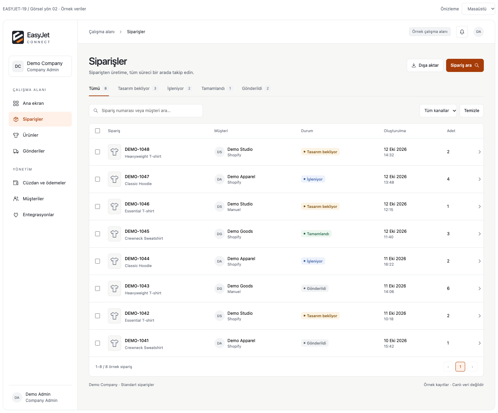

# EASYJET-19 — Görsel yön 02 / Sipariş listesi

Durum: **tek ekran önerisi, onay bekliyor**. Kullanıcı v0.1 görünümünü reddetti; eski tasarım uygulanmayacak. Çalışan uygulama, route/API/izin/iş mantığı değişmedi. PR #86 aynı docs-only branch'te revize ediliyor; merge veya deployment yok.

## İnceleme

[Masaüstü 1440px](previews/orders-v2-1440.png) · [Tablet 768px](previews/orders-v2-768.png) · [Mobil 375px](previews/orders-v2-375.png)

## Görsel değişiklik

- Teal ağırlığı kaldırıldı. Mevcut turuncu/beyaz logo korunuyor; vurgu daha az yerde ve daha koyu turuncu ile kullanılıyor. Logo yeniden tasarlanmadı.
- Beyaz navigation, hafif sıcak nötr çalışma yüzeyi; gölge/gradient/hero/KPI dolgu kartları yok.
- Daha belirgin sayfa başlığı; küçük, tutarlı ikonlar ve daha hafif ikincil kontroller.
- Aktif menü ve durum filtresi net; satırlar kimlik/ürün, müşteri/kanal, durum ve tarih hiyerarşisiyle düzenli.
- Her satırda büyük bir Detay düğmesi yerine tıklanabilir sipariş kimliği ve küçük detay kontrolü.
- Mobilde tabloyu küçültmek yerine aynı kaydın bilgilerini satır kartı halinde gösterme; durum sekmeleri yerel yatay kaydırmalı.

Bu sıralama/font/yoğunluk/renk yönü kesin Design System kararı değildir. Onaydan sonra tüm token/component state çiftleri ve kalan dört ekran bu yöne göre tamamlanır. Eski v0.1 token listesi onay bekleyen bu öneriyle karıştırılmaz.

## Prototype sınırı

8 DEMO kayıt; sayılar gerçek trafik/KPI değildir. Ürün ikonları temsilî, gerçek thumbnail değildir. CompanyAdmin menüsü sadeleştirilmiş görsel örnektir; production'da mevcut role/category izinli rotalar korunacak. Bir siparişte çoklu ürün varsa ilk ürünü tek gerçek kalemmiş gibi gösterme kuralı getirilmiyor; gerçek liste sözleşmesi uygulama pilotunda eşlenir.

Durum sekmesi, arama, kanal filtresi ve seçim yalnız yerel örnek veri üzerinde çalışır. Filtreden sonra selection reset sadece fixture davranışıdır; uygulamada mevcut selection/page/filter sözleşmesini değiştirme yetkisi değildir. Satır özeti tıklanan örnek siparişe özeldir. Gerçek detay sayfası/ödeme/üretim/kargo işlemine bağlanmaz. Dışa aktar/menü/bildirim/Sipariş ara düğmeleri demo açıklaması gösterir; bunların production fonksiyonu tamamlanmış sayılmaz.

## Doğrulama

Headless Chrome / bağımsız geçici Playwright aracı; projeye dependency veya test altyapısı eklenmedi.

- PASS: 375/768/1440px document yatay taşma kontrolü, üç PNG; masaüstü ve mobil görsel inceleme.
- PASS: durum sekmesi, numara araması, kanal filtresi, empty/reset, satır seçimi ve seçimi kaldırma.
- PASS: light/dark tema üzerinde üç genişlik; tıklanan kaydın doğru özet dialogu açılır, Escape ile kapanır; mobile menü açılır/kapanır; browser page error yok. Dış API/storage kullanılmadığı kontrol edildi. PNG'ler light temayı gösterir; dark tema görsel kullanıcı onayı değildir.
- Gerçek AntD uygulaması, API/role/tenant testleri ve WCAG tam state/focus/zoom incelemesi henüz yok. Gerçek ürün ve müşteri verisi kullanılmadı.
- Uygulama lint/build local N/A docs-only. PR CI sonucu ayrı takip edilir; bu kontrol görsel kullanıcı onayı yerine geçmez.

## Sonraki kapı

Kullanıcı önce bu tek ekranın görsel yönünü değerlendirir. Kabul edilmeden diğer ekranlar bu stile çevrilmez, EASYJET-20 başlamaz ve EASYJET-19 Done yapılmaz. Tasarım yönü kabulü ayrıca PR merge veya production deployment onayı değildir.
