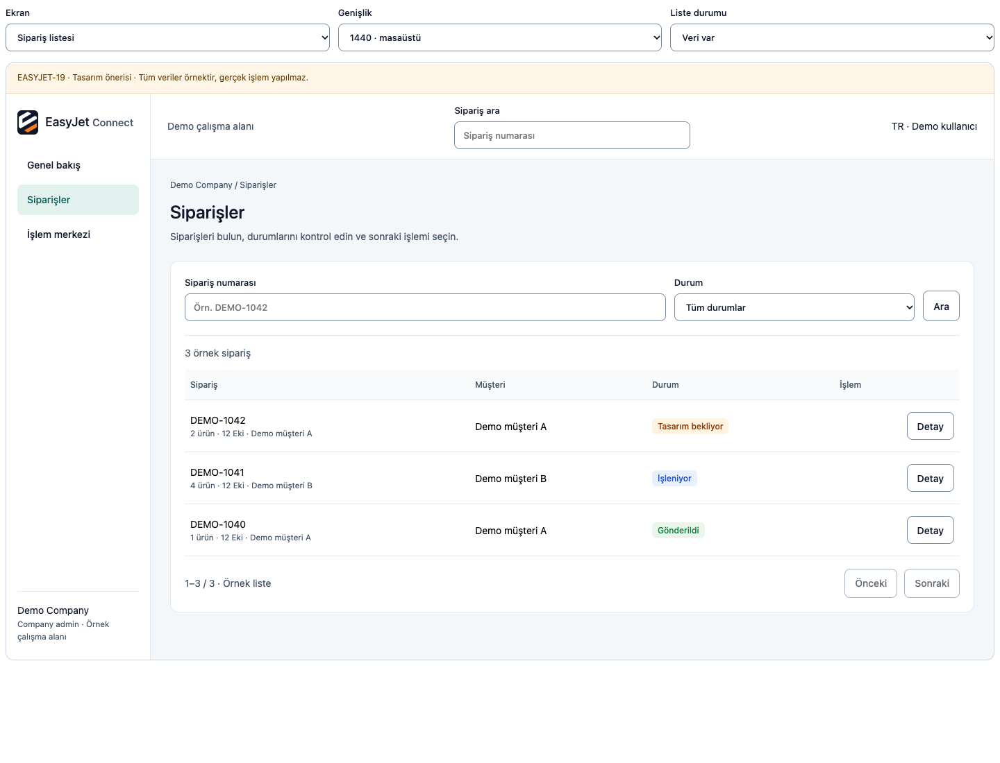
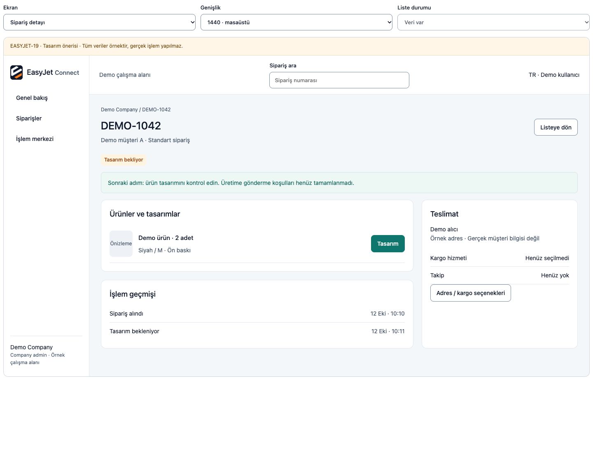
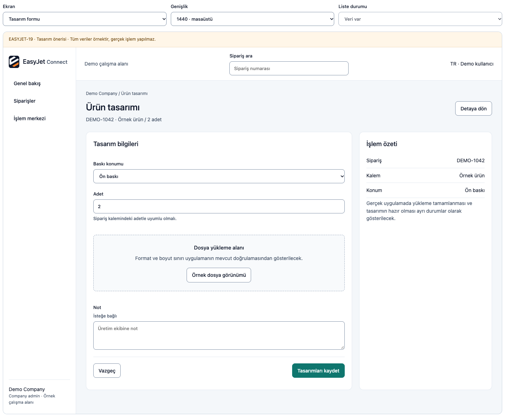
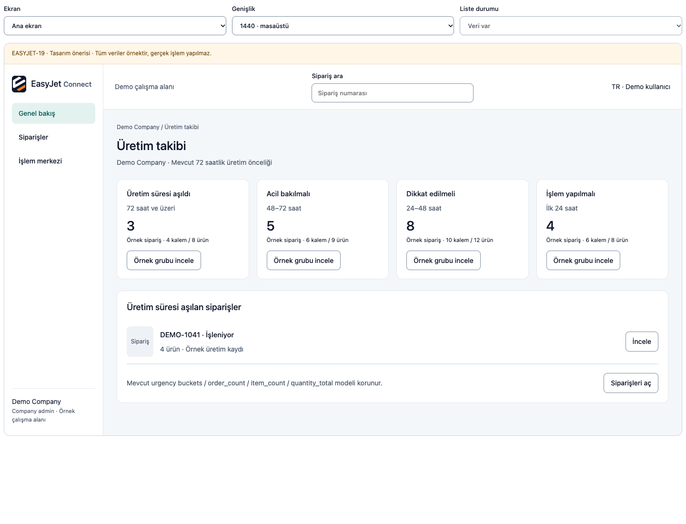
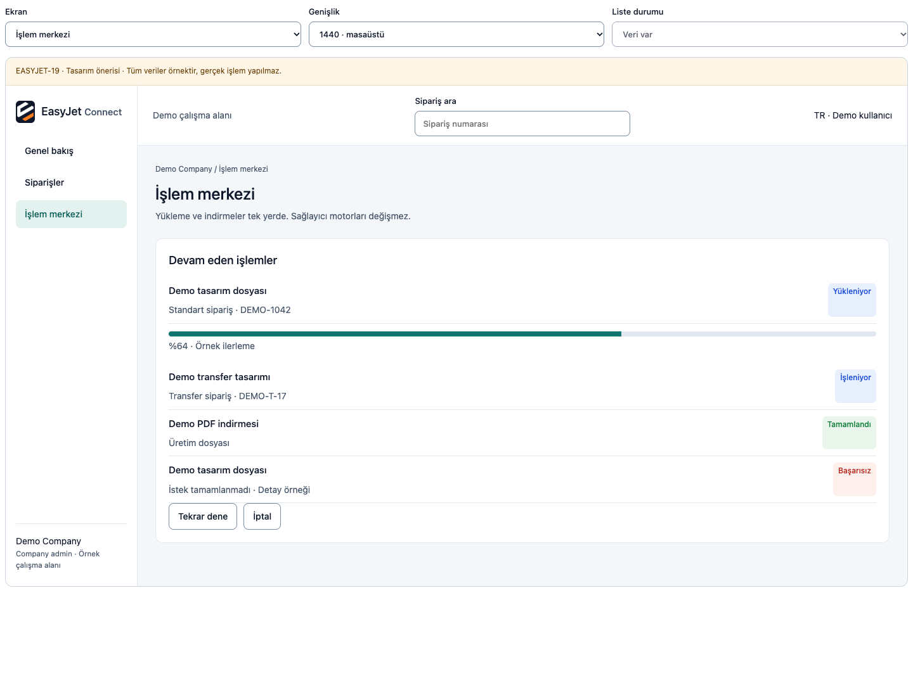

# EASYJET-19 — Beş ekran / üç genişlik taslağı

Durum: **v0.1 kullanıcı tarafından reddedildi. Aşağıdaki eski görseller uygulama referansı değildir; yalnız önceki inceleme kaydıdır.** Yeni tek ekran önerisi [visual-direction-v2.md](visual-direction-v2.md) içinde. DEMO veriler; gerçek dosya/API/işlem bağlantısı yok. [Tasarım kararları](design-spec.md) ve [rol/kategori/route kanıtı](role-route-matrix.md).

Ekran seçimi ve durum önizlemesi workspace reports/easyjet19-preview.html içinde yerel fixture'dır; PR'daki PNG'ler kullanıcı incelemesi için portable tasarım kanıtıdır. Form/kargo/production/modallarının nihai AntD davranışı sonradan uygulanır. Prototype bütün gerçek ekranların yerine geçmez. Satırdan detay geçişi temsilî DEMO-1042 örneğini gösterir; gerçek sipariş yönlendirmesi uygulama aşamasında korunacak.

## Sipariş listesi

375px: [mobil](previews/orders-375.png) · 768px: [tablet](previews/orders-768.png) · 1440px: [masaüstü](previews/orders-1440.png).

## Sipariş detayı

375px: [mobil](previews/detail-375.png) · 768px: [tablet](previews/detail-768.png) · 1440px: [masaüstü](previews/detail-1440.png).

## Tasarım formu

375px: [mobil](previews/form-375.png) · 768px: [tablet](previews/form-768.png) · 1440px: [masaüstü](previews/form-1440.png).

## Company üretim ana ekranı

375px: [mobil](previews/dashboard-375.png) · 768px: [tablet](previews/dashboard-768.png) · 1440px: [masaüstü](previews/dashboard-1440.png).

## Ortak işlem merkezi

375px: [mobil](previews/activity-375.png) · 768px: [tablet](previews/activity-768.png) · 1440px: [masaüstü](previews/activity-1440.png).

## Sunum onayı soruları

- Genel renk/boşluk/yoğunluk bu yönde ilerlesin mi?
- Company/Admin pilotu yerine Customer/Admin ekranına öncelik verilmeli mi?
- Sipariş listesi, detay ve formdaki sonraki adım yeterince anlaşılır mı?
- Mobilde navigation ve tek kolon form yaklaşımı kabul ediliyor mu?
- Activity center mevcut motorlar korunarak tek panel görünümünde olsun mu?

Gerçek kullanıcı/tenant/scanner/print/ödeme akışlarının testi yapılmadı. Bu wireframe onayı EASYJET-26 pilotunun fonksiyonel kabulü değildir.
